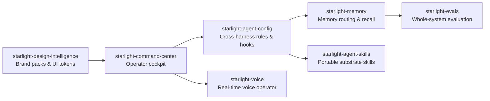

# Starlight Intelligence

Personal AI command center, memory engine, voice runtime, and cross-harness agent operating layer.

**Website:** [starlightintelligence.ai](https://starlightintelligence.ai) · **Ecosystem:** [Starlight Intelligence](https://github.com/Starlight-Intelligence) · [Starlight Systems](https://github.com/Starlight-Intelligence-Systems) · [Arcanea Labs](https://github.com/Arcanea-Labs) · [GenCreator](https://github.com/GenCreator-ai) · [FrankX](https://github.com/FrankX-AI)

---

## Overview

Starlight Intelligence builds the operational layer for multi-agent work: a unified command center, cross-harness configuration, hybrid memory routing, low-latency voice interaction, and deterministic evaluation harnesses.

## System topology



## Flagship repositories

| Repository | Purpose | Link |
| :--- | :--- | :--- |
| [**starlight-voice**](https://github.com/Starlight-Intelligence/starlight-voice) | Personal voice operator with local STT/TTS, session memory, and real-time visualization. | [Website](https://starlightintelligence.ai) |
| [**starlight-design-intelligence**](https://github.com/Starlight-Intelligence/starlight-design-intelligence) | Brand packs, typography scales, motion tokens, and editorial gates across the estate. | [Website](https://starlightintelligence.ai) |
| [**starlight-agent-skills**](https://github.com/Starlight-Intelligence/starlight-agent-skills) | Portable Starlight substrate skills for Claude Code, Codex, Cursor, Gemini, and OpenCode. | [Website](https://starlightintelligence.org) |
| [**starlight-evals**](https://github.com/Starlight-Intelligence/starlight-evals) | Whole-system evaluation harness testing models, memory recall, skills, and multi-agent routing. | [Website](https://starlightintelligence.org) |
| [**starlight-technology**](https://github.com/Starlight-Intelligence/starlight-technology) | Hardware sizing, local inference benchmarks, and workstation architecture guides. | [Website](https://starlightintelligence.ai) |

## Quickstart

```bash
# Install portable Starlight substrate skills
npx @starlight-intelligence/sis@latest init

# Run whole-system evaluation checks
git clone https://github.com/Starlight-Intelligence/starlight-evals.git
cd starlight-evals && npm test
```

## Engineering standards

Every repository in **Starlight Intelligence** follows the Starlight estate engineering contract:

1. **Draft-first pull requests**: Open pull requests in draft mode (`gh pr create --draft`). CI workflows run only when a pull request is marked ready for review or lands on `main`.
2. **Independent verification**: Maker harness and Checker harness must differ (`Maker-Harness` != `Checker-Harness`).
3. **Zero committed secrets**: Credentials live in local environment files or Infisical. Pre-commit and CI gates reject secret patterns.
4. **Editorial clarity**: Public documentation uses sentence case headings, concrete verbs, and verified metrics.

---

<sub>Maintained by <a href="https://github.com/frankxai">Frank Riemer (frankxai)</a> · Built on the <a href="https://github.com/Starlight-Intelligence-Systems/Starlight-Intelligence-System">Starlight Intelligence Protocol (SIP)</a></sub>
