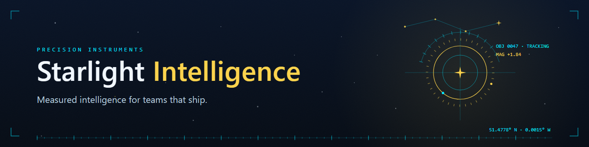
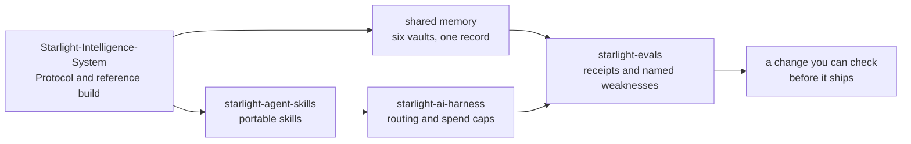



Starlight Intelligence builds the layer that keeps a fleet of AI coding agents coherent: one shared memory, one configuration, and a verifier that is never the agent that wrote the change.

## Start here

| If you want to | Go to |
| :--- | :--- |
| **Use the product** | [starlightintelligence.ai](https://starlightintelligence.ai) — plan a crew, follow a recorded mission, inspect its sources and files |
| **Read the protocol** | [starlightintelligence.org/protocol](https://starlightintelligence.org/protocol) — SIP v1.1.1: file contract, attestation, MCP registry, command taxonomy |
| **Run the code** | [`Starlight-Intelligence-System`](https://github.com/Starlight-Intelligence/Starlight-Intelligence-System) — read `SIP.md`, then `SETUP.md`; MIT |

## Do the work

| Repository | What you get |
| :--- | :--- |
| [**Starlight-Intelligence-System**](https://github.com/Starlight-Intelligence/Starlight-Intelligence-System) | The SIP contract plus the reference build: six memory vaults, an MCP server, and agent definitions that several coding tools read from one set of files. |
| [**starlight-agent-canvas**](https://github.com/Starlight-Intelligence/starlight-agent-canvas) | A local canvas where sources, prompts, MCP calls and agent runs become typed nodes you can inspect and export as context for another agent. |
| [**starlight-agent-skills**](https://github.com/Starlight-Intelligence/starlight-agent-skills) | Skill files for Claude Code, Codex, Cursor, Gemini, Grok and OpenCode, installed with `npx skills add`. |
| [**starlight-ai-harness**](https://github.com/Starlight-Intelligence/starlight-ai-harness) | A routing schema for task classes and model chains, spend caps, deterministic eval checkers, and one receipt per model call. |
| [**starlight-voice**](https://github.com/Starlight-Intelligence/starlight-voice) | A Tauri tray and Python sidecar for push-to-talk control of local agents; the README lists live audio, latency and RAM acceptance as pending. |
| [**starlight-design-intelligence**](https://github.com/Starlight-Intelligence/starlight-design-intelligence) | Brand packs, UI rubrics and motion rules used to review interface work for FrankX, Starlight and Arcanea. |
| [**starlight-academy-plugin**](https://github.com/Starlight-Intelligence/starlight-academy-plugin) | Five learning skills, eight local MCP tools and four practice missions, packaged for the Codex and Claude marketplaces. |
| [**marketing-intelligence**](https://github.com/Starlight-Intelligence/marketing-intelligence) | Marketing skills and an agent team that draft and stage work; publishing, sending and spending stay with a person. |

## Check the work

| Repository | What you get |
| :--- | :--- |
| [**starlight-evals**](https://github.com/Starlight-Intelligence/starlight-evals) | Eval runs for models, memory, retrieval and routing that publish receipts and name the weakness a run exposed. |

The kernel that signs mission receipts, the held-out task set behind the sales playbooks, and the operator cockpit are private while they stabilise. No public repository above depends on them to run.

## Read the research

| Repository | What you get |
| :--- | :--- |
| [**starlight-knowledge-tree**](https://github.com/Starlight-Intelligence/starlight-knowledge-tree) | A graph of domains, concepts, skills, papers and open problems, with a contribution path on each node. |
| [**starlight-technology**](https://github.com/Starlight-Intelligence/starlight-technology) | Buying research for AI hardware and studio systems, with evidence status and wrong-purchase conditions on each recommendation. |
| [**starlight-genius-forge**](https://github.com/Starlight-Intelligence/starlight-genius-forge) | An agent-run talent discovery and competition platform aimed at Japan, the Philippines and Indonesia, with a supporter community attached. |

## How the repositories fit

## For agents

Read these in order before you act in any repository here:

1. [`ORG-MAP.md`](./ORG-MAP.md) — every active repository with its status, entry command, language and visibility. Use it to route yourself in one read.
2. [`AGENTS.md`](./AGENTS.md) — the operating contract: branch naming, draft pull requests, maker/checker separation, secret hygiene, and spend rules.
3. [`VOCABULARY.md`](./VOCABULARY.md) — the 23 terms the charter uses, so a plan reads the same way to every agent in the fleet.

Machine-readable surfaces on the live site:

- `https://starlightintelligence.ai/llms.txt` and `https://starlightintelligence.ai/llms-full.txt` — the discovery index, and the expanded version that carries the section text.
- `https://starlightintelligence.ai/.well-known/agent.json` — agent discovery record.
- `https://starlightintelligence.ai/mcp` — the read-only MCP endpoint. It answers POST; a GET returns 405 by design.
- `https://starlightintelligence.org/sip.md` — the protocol spec as `text/markdown`, for citation-stable reads.

## Engineering standards

1. **Draft-first.** A pull request starts as a draft and is marked ready when its checks pass.
2. **Independent verification.** The harness that made the change is not the harness that approves it.
3. **No committed secrets.** Credentials live in local environment files or a secret manager; pre-commit and CI reject secret patterns.
4. **Evidence over adjectives.** A claim points at a run, a file, or a URL that resolves.

Every repository states its own state at the top of its README: active, pilot, or retired. Retired repositories are archived rather than deleted, and each carries a note naming its successor.

## Related

Sister organisations: [Starlight Systems](https://github.com/Starlight-Intelligence-Systems) · [Arcanea Labs](https://github.com/Arcanea-Labs) · [GenCreator](https://github.com/GenCreator-ai) · [FrankX](https://github.com/FrankX-AI)

---

Maintained by <a href="https://github.com/frankxai">Frank Riemer</a> · Built on the <a href="https://starlightintelligence.org/protocol">Starlight Intelligence Protocol</a>
