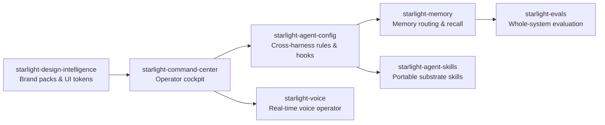

# Starlight Intelligence

**One public home for the Starlight open ecosystem.** Build sovereign AI systems from modular protocol, memory, skills, evals, voice and orchestration components. Adopt the whole stack or just the interfaces you need.

**Start here:** [Join the community](https://github.com/Starlight-Intelligence/.github/blob/main/COMMUNITY.md) · [Contribute](https://github.com/Starlight-Intelligence/.github/blob/main/CONTRIBUTING.md) · [Organization map & consolidation](https://github.com/Starlight-Intelligence/.github/blob/main/docs/ORGANIZATION-MAP.md) · [Community operations](https://github.com/Starlight-Intelligence/.github/blob/main/docs/COMMUNITY-OPERATIONS.md)

> **November 2026 proposal:** `Starlight-Intelligence` would become the single public Starlight GitHub organization, subject to owner adoption and each repository's migration gates. **SIP** is the protocol; **SIS** is its reference implementation. The existing `Starlight-Intelligence-Systems` organization and original repositories under `frankxai` remain active—please follow each repo's declared source of truth rather than opening duplicate PRs.

Personal AI command center, memory engine, voice runtime, and cross-harness agent operating layer.

**Website:** [starlightintelligence.ai](https://starlightintelligence.ai) · **Ecosystem:** [Starlight Intelligence](https://github.com/Starlight-Intelligence) · [Starlight Systems](https://github.com/Starlight-Intelligence-Systems) · [Arcanea Labs](https://github.com/Arcanea-Labs) · [GenCreator](https://github.com/GenCreator-ai) · [FrankX](https://github.com/FrankX-AI)

---

## Overview

Starlight Intelligence builds the operational layer for multi-agent work: a unified command center, cross-harness configuration, hybrid memory routing, low-latency voice interaction, and deterministic evaluation harnesses.

## System topology



## Repositories and contribution routes

The organization copies are federated mirrors under the current operating contract. Follow each linked repository's own contribution and provenance instructions until a reviewed migration changes that contract. Starlight Evals is itself a publication mirror: methodology changes belong in [SIS](https://github.com/frankxai/Starlight-Intelligence-System/tree/main/tools/proving-ground).

| Repository | Purpose | Link |
| :--- | :--- | :--- |
| [**starlight-voice**](https://github.com/frankxai/starlight-voice) | Personal voice operator with local STT/TTS, session memory, and real-time visualization. | [Website](https://starlightintelligence.ai) |
| [**starlight-design-intelligence**](https://github.com/frankxai/starlight-design-intelligence) | Brand packs, typography scales, motion tokens, and editorial gates across the estate. | [Website](https://starlightintelligence.ai) |
| [**starlight-agent-skills**](https://github.com/frankxai/starlight-agent-skills) | Portable Starlight substrate skills for Claude Code, Codex, Cursor, Gemini, and OpenCode. | [Website](https://starlightintelligence.org) |
| [**starlight-evals**](https://github.com/frankxai/starlight-evals) | Whole-system evaluation harness testing models, memory recall, skills, and multi-agent routing. | [Website](https://starlightintelligence.org) |
| [**starlight-technology**](https://github.com/frankxai/starlight-technology) | Hardware sizing, local inference benchmarks, and workstation architecture guides. | [Website](https://starlightintelligence.ai) |

## Inspect before installing

Browse the [skills catalog](https://github.com/frankxai/starlight-agent-skills/blob/main/docs/CATALOG.md) and select only the capabilities your task needs. Read the selected skill's instructions and source before adding it to a harness. This profile does not advertise an npm installer until a published package and its commands are verified.

For a small source-only check, the [Evals README](https://github.com/frankxai/starlight-evals#90-second-start) documents receipt validation with Node.js 22+. The commands below do not install dependencies or run model evaluations. This is a documented path, not a clean-machine execution receipt; [report reproducible problems](https://github.com/Starlight-Intelligence/.github/blob/main/COMMUNITY.md).

```bash
# Validate published JSON receipts
git clone https://github.com/frankxai/starlight-evals.git
cd starlight-evals
npm run validate
```

## Engineering standards

Every repository in **Starlight Intelligence** follows the Starlight estate engineering contract:

1. **Draft-first pull requests**: Open pull requests in draft mode (`gh pr create --draft`). CI workflows run only when a pull request is marked ready for review or lands on `main`.
2. **Independent verification**: Maker harness and Checker harness must differ (`Maker-Harness` != `Checker-Harness`).
3. **Zero committed secrets**: Credentials live in local environment files or Infisical. Pre-commit and CI gates reject secret patterns.
4. **Editorial clarity**: Public documentation uses sentence case headings, concrete verbs, and verified metrics.

---

<sub>Maintained by <a href="https://github.com/frankxai">Frank Riemer (frankxai)</a> · Built on the <a href="https://github.com/frankxai/Starlight-Intelligence-System">Starlight Intelligence Protocol (SIP)</a></sub>
