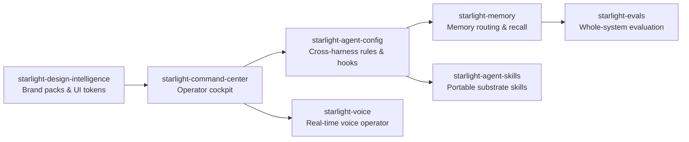



Personal AI command center, memory engine, voice runtime, and cross-harness agent operating layer.

Running more than one coding agent is now normal. Starlight builds the layer that keeps them coherent: one
cockpit, one configuration, one memory, one voice, and an evaluation harness that checks the parts still
work together after every change.

**Website** [starlightintelligence.ai](https://starlightintelligence.ai) · **Protocol** [starlightintelligence.org/protocol](https://starlightintelligence.org/protocol) · **Sister orgs** [Starlight Systems](https://github.com/Starlight-Intelligence-Systems) · [Arcanea Labs](https://github.com/Arcanea-Labs) · [GenCreator](https://github.com/GenCreator-ai) · [FrankX](https://github.com/FrankX-AI)

---

## Public repositories

| Repository | What it does |
| :--- | :--- |
| [**starlight-voice**](https://github.com/Starlight-Intelligence/starlight-voice) | Personal voice operator: Tauri tray, Pipecat sidecar, push-to-talk with a sub-800 ms hot path. |
| [**starlight-design-intelligence**](https://github.com/Starlight-Intelligence/starlight-design-intelligence) | Brand packs, motion systems, and interface review doctrine for FrankX, Starlight, and Arcanea. |
| [**starlight-agent-skills**](https://github.com/Starlight-Intelligence/starlight-agent-skills) | Portable substrate skills for Claude Code, Codex, Cursor, Gemini, and OpenCode. |
| [**starlight-evals**](https://github.com/Starlight-Intelligence/starlight-evals) | Evaluation harness for models, memory, retrieval, and multi-agent routing. |
| [**starlight-technology**](https://github.com/Starlight-Intelligence/starlight-technology) | Hardware sizing, local inference benchmarks, and buying intelligence for AI-native teams. |
| [**marketing-intelligence**](https://github.com/Starlight-Intelligence/marketing-intelligence) | Agentic marketing system: content, search, and distribution patterns with worked examples. |

The cockpit, kernel, agent configuration, and memory routing are private while they mature. Each public
repository above is usable without the private layer.

## System topology



## Start here

```bash
# Memory provider contract and CLI
npm install @starlight-intelligence/memory

# Run the evaluation harness
git clone https://github.com/Starlight-Intelligence/starlight-evals.git
cd starlight-evals && npm install && npm test
```

## Engineering standards

Every repository in this org follows the Starlight estate contract:

1. **Draft-first pull requests.** A pull request starts as a draft and is marked ready when its checks pass.
2. **Independent verification.** The harness that made the change is not the harness that approves it.
3. **No committed secrets.** Credentials live in local environment files or Infisical; pre-commit and CI reject secret patterns.
4. **Readable documentation.** Sentence case headings, concrete verbs, and claims that point at evidence.

## Repository status

Every repository states its own state at the top of its README: active, experimental, or retired. Retired
repositories are archived rather than deleted, and each one carries a note naming its successor.

---

<sub>Maintained by <a href="https://github.com/frankxai">Frank Riemer</a> · Built on the <a href="https://github.com/Starlight-Intelligence-Systems/Starlight-Intelligence-System">Starlight Intelligence Protocol</a></sub>
